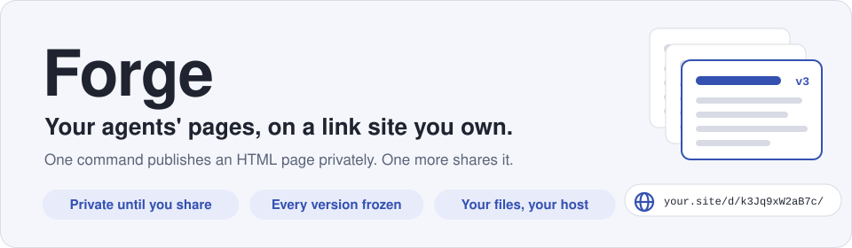
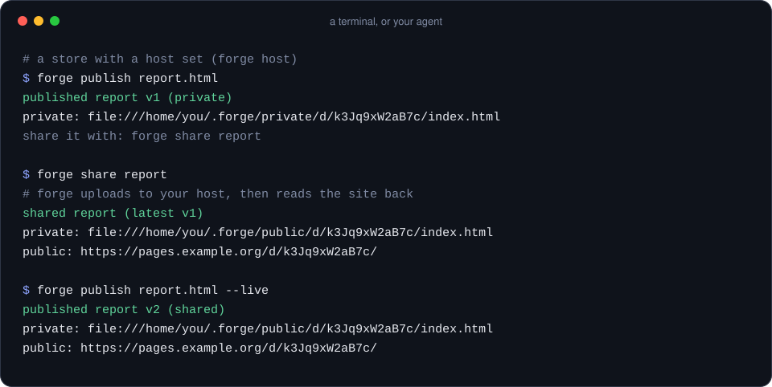
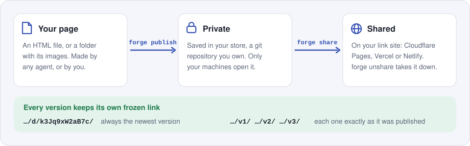

<p align="center">
  <picture>
    <source media="(prefers-color-scheme: dark)" srcset="docs/assets/hero-dark.svg">
    <source media="(prefers-color-scheme: light)" srcset="docs/assets/hero-light.svg">
    
  </picture>
</p>

<p align="center">
  <a href="https://github.com/rishmadaan/forge-artifacts/releases"></a>
  <a href="https://github.com/rishmadaan/forge-artifacts/actions/workflows/ci.yml"></a>
  <a href="LICENSE"></a>
</p>

<p align="center">
  <a href="#quick-start">Quick start</a> ·
  <a href="#forge-and-chat-app-artifacts">Forge and chat-app artifacts</a> ·
  <a href="SETUP.md">Setup guide</a> ·
  <a href="docs/reference.md">Reference</a> ·
  <a href="ROADMAP.md">Roadmap</a> ·
  <a href="CHANGELOG.md">Changelog</a>
</p>

Forge is a private-by-default page publisher any AI agent can use: your own
alternative to the artifact features inside chat apps. An agent (or you) runs
one command on an HTML file, or a folder with an `index.html` and its images,
and gets a link. A new page is private. One more command puts it on a link
site you own. Every version stays frozen at its own link, and everything lives
as plain files in a git repository you own.

<p align="center">
  
</p>

## Why Forge

Pages made by agents (reports, plans, explainers, mockups, decks) are worth
keeping, sending and updating. They should not live inside whichever chat tool
happened to make them.

- **Works with every agent.** Any model or harness that can run a command can
  publish: Claude Code, Codex, Gemini, a script, or you in a terminal. The
  `publish` skill teaches agents the rules. `forge` writes to its store
  outside the current folder and uses the network, so a sandboxed session has
  to run it outside its sandbox.
- **More than the host's upload command.** `wrangler`, `vercel deploy` and
  `netlify deploy` put files online. Forge adds the rest: pages private by
  default, every version at a frozen link, a git store you own, a link site
  on Cloudflare Pages, Vercel or Netlify, share and unshare, a read-back of
  the live site, and a skill any agent follows.
- **Private until you say.** A new page is private. Sharing is a separate step,
  and a shared page changes only when you ask with `--live`.
- **Older versions stay.** The stable link shows the newest version; every
  earlier version stays at its own frozen link.
- **Yours, end to end.** The store is a git repository you own; the public
  site is on your own host account, at its address or your own domain.
  Nothing to export when you leave.
- **Reads well everywhere.** Each page gets a dark-mode switch (unless it is
  dark-only) and Markdown copy and download buttons; your source file is not
  changed.
- **Refuses instead of guessing.** Every command finishes, refuses and changes
  nothing, or says exactly what is left; it never reports success it has not
  read back from the live site.

<p align="center">
  <picture>
    <source media="(prefers-color-scheme: dark)" srcset="docs/assets/how-it-works-dark.svg">
    <source media="(prefers-color-scheme: light)" srcset="docs/assets/how-it-works-light.svg">
    
  </picture>
</p>

## Forge and chat-app artifacts

Chat apps and coding agents can turn a model's output into a shareable page
too. The difference is who holds the pages and who can make them. Checked
against Claude's artifacts; vendors change fast, so check theirs.

| | Forge | Claude's artifacts (checked November 2026) |
|---|---|---|
| Who can publish | Any agent or harness that runs a command, or you | That vendor's apps |
| Where pages are kept | Plain files in a git repository you own | The vendor's servers |
| Public links | Your host account, at its address or your own domain (Cloudflare Pages, Vercel, Netlify) | The vendor's domain |
| Private by default | Yes | Yes |
| Versions | Every version at its own frozen link | One link, showing the version you pick |
| Leaving | Nothing to export: it is already yours | Export per page type; the link and its history stay with the vendor |
| Pages that call the model, store data, or read your apps | No: static pages only | Yes |
| Comments, roles, team sharing | Comments: next on the [roadmap](ROADMAP.md). Roles and invites: later (pages behind a sign-in) | Yes, on some plans |
| Cost | Free and open source; hosting on your host's plan (all three have free tiers) | Part of the vendor's plan |

**When a chat-app artifact is the better fit:** an interactive tool that calls
the model or keeps shared data, a team that comments together in one app, or
a page you need in a minute with nothing set up.

## Quick start

```sh
git clone https://github.com/rishmadaan/forge-artifacts ~/forge-artifacts
~/forge-artifacts/bin/install     # links the forge command and the publish skill
forge init                        # your store at ~/.forge (forgee init if the installer said forgee)
```

The installer says if `~/.local/bin` is not on your PATH (add it), and whether
it installed the command as `forgee` (another program already had the name
`forge`: type `forgee` instead). `forge init` needs git's `user.name` and
`user.email`; it says how to set them.

```
$ forge publish report.html
published report v1 (private)
private: file:///home/you/.forge/private/d/k3Jq9xW2aB7c/index.html
to share it: set a host first with forge host (SETUP.md step 5), then run forge share report
$ forge share report       # once a host is set: public: https://pages.example.org/d/k3Jq9xW2aB7c/
```

<p align="center">
  
</p>

<p align="center"><em>Recorded with Forge's test host standing in for Cloudflare Pages (the <code>fake host:</code> lines), so no page left this machine and the public link is a local address; with your own host it is on your site. The last frames are the shared page and its history page.</em></p>

**Setting it up with an agent:** point your agent at [SETUP.md](SETUP.md). It
is written for an agent to walk a person through every step, including
connecting a host.

## Install

macOS and Linux only. Needs Node 22 or newer (with `npx`, which comes with it),
git, and perl (for the store lock). No npm packages are installed: a deploy
runs the host's official CLI through `npx --yes <cli>@latest`.

1. Clone this repository anywhere (the line above).
2. Run `bin/install` (then `bin/install --check`). It links the command into
   `~/.local/bin` and the `publish` skill into `~/.agents/skills/publish` and
   `~/.claude/skills/publish`. Make sure `~/.local/bin` is on your `PATH`.
3. Make a store: `forge init` (at `~/.forge`), or `forge init <path>`. To share
   pages, set a host when you want to (see [Hosts](#hosts)). On a second
   machine, clone the store's remote and run `forge store <path>`.

Update with `forge update` (`forge update --check` only looks). Each release is
listed in [CHANGELOG.md](CHANGELOG.md) and on the
[releases page](https://github.com/rishmadaan/forge-artifacts/releases); on
GitHub, Watch, then Custom, then Releases tells you of a new one. Run
`forge update` when no other forge command is running.

### From your agent's plugin store

A plugin store gives your agent the `publish` skill, not the `forge` command.
Install the skill from the one your agent uses:

```sh
# Claude Code
claude plugin marketplace add rishmadaan/forge-artifacts
claude plugin install forge-artifacts@forge-artifacts
```

```sh
# Gemini CLI
gemini extensions install https://github.com/rishmadaan/forge-artifacts
```

```sh
# skills.sh (add -g for every project)
npx skills add rishmadaan/forge-artifacts
```

Then install the command from a clone. `--no-skill` skips the skill, since the
store brought it:

```sh
git clone https://github.com/rishmadaan/forge-artifacts ~/forge-artifacts && ~/forge-artifacts/bin/install --no-skill
```

Already installed with plain `bin/install`? Run `bin/install --no-skill` once,
so your agent does not see the skill twice.

`forge update` updates the command only. Update the skill with your store's
own command: `claude plugin update forge-artifacts@forge-artifacts`,
`gemini extensions update forge-artifacts`, or `npx skills update`.

### `forge` or `forgee`

If another program named `forge` is already on your `PATH`, `bin/install`
leaves that name to it and installs this one as **`forgee`**, and records the
choice. Choose it yourself with `bin/install --command forge` or
`bin/install --command forgee`. This tool's `--version` prints
`Forge <version>`; that is how the installer tells the two apart. An agent
learns this machine's name from its instructions, else the `command` key in
your setting file, else `bin/install --check` (docs/reference.md, "The
command's name"). Every command forge prints for you to run uses the name you
started it as.

## Commands

| Command | What it does |
|---|---|
| `forge publish <file.html \| folder> [--name <name>] [--live]` | Publish a page, or a new version of one. A new page is private. A shared page is updated only with `--live`. Unchanged content is a no-op. |
| `forge open <name>` | Open a page's private link in your browser. |
| `forge list [--json] [--live]` | Every page with its links; `--live` reads the link site now. |
| `forge share <name> [note]` | Put a page on the link site; prints its `public:` link once the site is read back showing it. |
| `forge unshare <name> [--version N]` | Take a page, or one old version, off the link site. Nothing is deleted. |
| `forge rename <old> <new>` | Change a page's name only; links, versions and visibility stay. Refused when `<new>` is taken or breaks the name rule (below). |
| `forge host <kind> ...` | Set the link site's host, so pages can be shared (see [Hosts](#hosts)). |
| `forge init [<path>]` | Make a store (default `~/.forge`); private pages work at once. |
| `forge store [<path>]` | Say which store forge uses and why; with a path, use that one. |
| `forge update [--check]` | Update Forge to its newest release, or only check for one. |
| `forge check`, `deploy`, `sync`, `recover`, `regenerate`, `import` | Check the store, bring the link site level, catch up, clean up after an interrupted command, rebuild generated pages, move an existing site in. |

Every command that writes the store ends with one exit code: 0 finished; 1
refused, nothing changed; 3 saved, but the link site is not confirmed (do the
step after `finish with:`); 4 not known whether the change was saved; 75 the
store was busy. `forge update` changes Forge itself, not the store, and has
its own exit codes (in the reference): its exit 1 does not always mean nothing
changed. Each command in full, the safety rules, and what a tool built on forge
can rely on are in [docs/reference.md](docs/reference.md).

## Private and shared

- **Private link**: every page has one. By default it is the page's file in
  this machine's copy of the store; `forge open <name>` opens it. Set
  `privateBaseUrl` in the store's `config.json` when something on your
  machines serves the store at one address.
- **Public link**: only after `forge share <name>`, on your link site. Privacy
  there is the link itself: 12 random characters, `noindex`, no login. Sending
  a link shares the page; `forge unshare` takes it down again.
- **Earlier versions**: sharing a page shares its earlier versions too; its
  history page lists them for anyone with the link. To keep one off the link
  site, run `forge unshare <name> --version N` before sharing (it needs a host
  set; after sharing it takes the version down, but it was public until then),
  or publish a clean copy under a new `--name`.

## Page names

A page's name is what `forge share`, `forge unshare` and `publish --name` take.
Every name fits one rule: `^[a-z0-9][a-z0-9._-]*$`, at most 100 characters,
not digits only. A name taken from the file name is fitted to it
(`My Plan.html` becomes `my-plan`); a name you give that breaks it is refused,
naming the nearest name that fits.

## Where the store lives

forge uses, in this order: the `FORGE_WORKSPACE` environment variable; the
`store` in your setting file (`$XDG_CONFIG_HOME/forge/settings.json`, else
`~/.config/forge/settings.json`); `~/.forge`. `forge store` prints the store in
use and where that came from; `forge store <path>` records another one. When
there is no store where forge looks, every command that needs a store stops
and says so; it never falls back to another store. Give the store a private
git remote to use it from several machines.

## Hosts

The link site is a static site on a host you own. Set it once with
`forge host <kind> --project <p> [--account <id>] --url <https://...>`: it
checks the token, saves the host, deploys the link site and reads it back.
After every upload forge reads the live marker back; that is the only proof
it accepts that the site is live.

| `<kind>` | `forge host` needs | Token (default name) | Tested |
|---|---|---|---|
| `cloudflare-pages` | `--project`, `--account` (the account ID) | Cloudflare API token, Pages Edit (`FORGE_CLOUDFLARE_TOKEN`) | for real |
| `vercel` | `--project` (`prj_...`), `--account` (the team ID) | Vercel token (`FORGE_VERCEL_TOKEN`) | against a stand-in host only |
| `netlify` | `--project` (the site's Project ID) | Netlify personal access token (`FORGE_NETLIFY_TOKEN`) | against a stand-in host only |

"Against a stand-in host only" means the tests run the real deploy path against
a fake CLI and a local server, not the host itself. The token is read by name:
from the environment, then from `secretCommand` in your setting file, a command
with `{name}` where the name goes (for example `"op read op://Private/{name}/credential"`).
SETUP.md says how to make each host's project and token; docs/adding-a-host.md
says how to add another host.

## Limits

- macOS and Linux only (the store lock uses `flock` through perl).
- Static pages only: no server code, no database, no calls to a model.
- Cloudflare Pages is tested for real; Vercel and Netlify against a stand-in.
- A private link without `privateBaseUrl` is a file on this machine.
- What is next is in [ROADMAP.md](ROADMAP.md).

## FAQ

**Does it need a server?** No. Pages are static files on a host's free tier,
uploaded with the host's own CLI.

**Can I use it without an AI agent?** Yes: every step is a plain command.

**Can someone find my shared pages?** Only with a link. Pages are `noindex`
and links are 12 random characters. The master index that lists your shared
pages has an unguessable link of its own, which you can keep to yourself.

**What if I stop using Forge?** Your store is a git repository of HTML files,
and your link site keeps serving what it has. There is nothing to export.

**Do older versions stay?** Yes. Every version is frozen at its own link; the
stable link shows the newest. Sharing a page shares its earlier versions too
(see [Private and shared](#private-and-shared)).

**Why not just run wrangler?** For one upload, you can; Forge runs the host's
own CLI too. What it adds is in [Why Forge](#why-forge): privacy by default,
frozen versions, a store you own, share and unshare, and a read-back of every
upload.

## Contributing

Issues and pull requests are welcome. Run the tests with `node test/run.js`
(and `node test/mutate.js`, which checks that every guard's test can fail).
[AGENTS.md](AGENTS.md) holds the rules the code follows.

## License

MIT. See [LICENSE](LICENSE).
